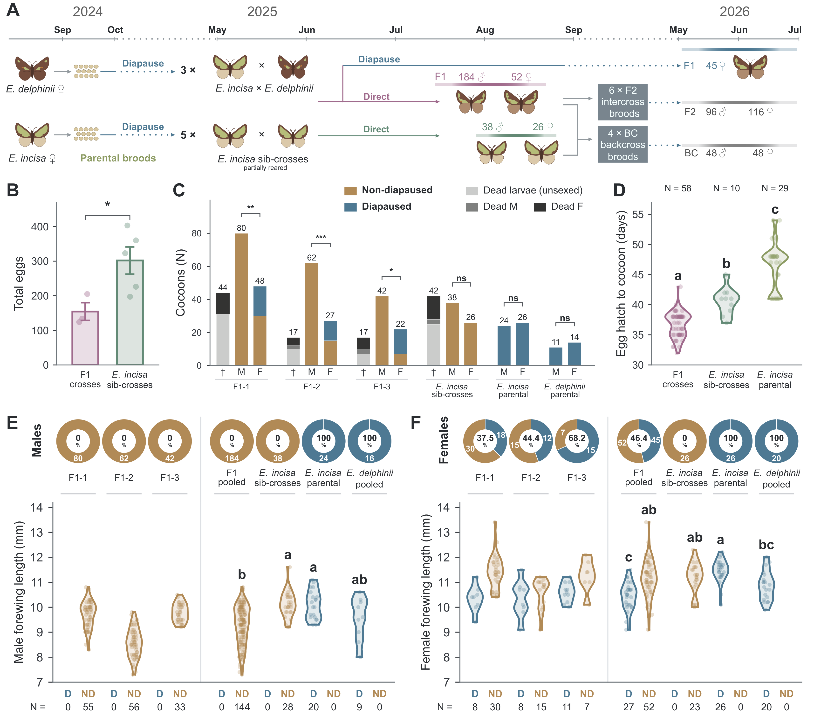

# F1 Brood Plots

Figure 2 documents the crossing scheme and early-life and adult outcomes of *Euclea incisa* × *E. delphinii* F1 broods and parental controls. Use the [style guide](docs/STYLE.md) and the current figure as references when preparing related figures.

[Illustrator figure](record/Fig2_F1-broods_v2.ai) · [Publication PDF](outputs/Fig2_F1-broods_record.pdf) · [450 dpi PNG](outputs/Fig2_F1-broods_record.png) · [Methods](docs/METHODS.md)



## Reproduce the figure

Run these commands from `f1-brood-plots/` with Python 3.12.

```sh
python -m venv .venv
source .venv/bin/activate
python -m pip install -r requirements.txt
python scripts/statistics.py
python scripts/regenerate.py
python scripts/render_record.py
```

- `statistics.py` reruns the analyses in [`results/`](results/), including adult sex ratios and the compact-letter audit.
- `regenerate.py` reuses the crossing schematic from the current Illustrator figure and rebuilds panels B–F from [`data/`](data/). It writes a draft PDF and PNG to `outputs/regenerated_from_data.*`. The draft approximates the final layout. Use the Illustrator figure as the reference for final placement and styling.
- `render_record.py` exports the current Illustrator file’s embedded page to PDF and PNG. Its SHA-256 and source timestamp are in [`manifest.json`](manifest.json).

The plotting scripts use installed Arial when available. Locally licensed Arial fonts can also be placed in `assets/fonts/`. Builds without Arial use Liberation Sans or DejaVu Sans. The Illustrator record and its exports preserve their original typography.

## Data

| File | Contents |
| --- | --- |
| [eggs.csv](data/eggs.csv) | Egg counts per cross |
| [survival.csv](data/survival.csv) | Starting numbers, cocoon outcomes, and adult counts by sex and diapause |
| [parental_adult_counts.csv](data/parental_adult_counts.csv) | Adult counts for the two 2024 parental broods |
| [development.csv](data/development.csv) | Individual hatch-to-cocoon durations in days |
| [individuals.tsv](data/individuals.tsv) | Sex, diapause status, wing measurement status, and forewing length |

Egg totals and survival starting numbers use distinct denominators. Donuts use all eligible adults with recorded diapause status. Forewing plots use measured individuals. The pooled F1 category repeats the three individual F1 broods for display. After changing data, rerun the audit and review significance labels and axis limits before exporting.
